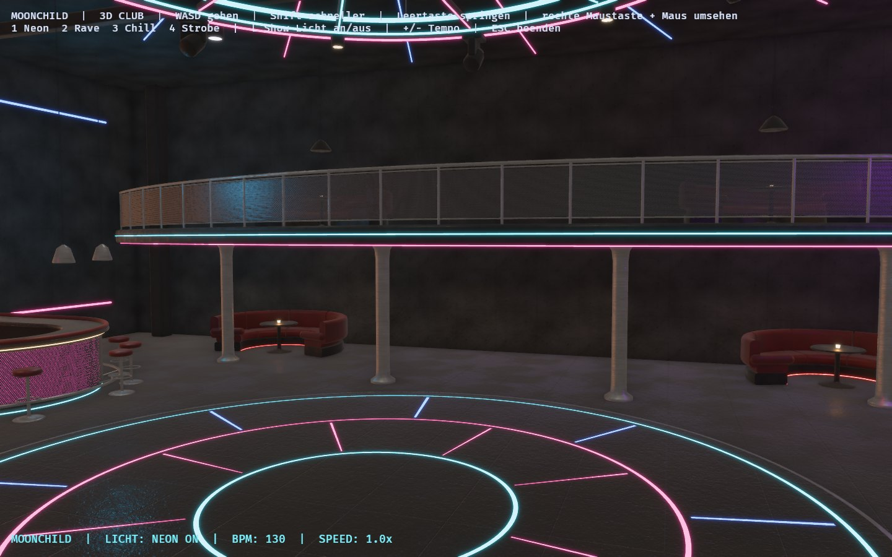

# MOONCHILD 3D

Ein kostenloser, selbst gebauter begehbarer Techno-Club in Rust und Bevy 0.20.1. Geometrie und Texturen werden für Moonchild selbst erzeugt. Kostenpflichtige Modelle, Texturen oder Dienste sind nicht nötig.



## Start auf CachyOS / Arch Linux

```bash
sudo pacman -S --needed rustup base-devel clang lld pkgconf alsa-lib libx11 libxcursor libxi libxrandr wayland libxkbcommon libxkbcommon-x11 vulkan-radeon vulkan-tools
rustup default stable
git clone https://github.com/ashrynsilkstone-ui/moonchild-3d.git
cd moonchild-3d
cargo run --release
```

Paketnamen und Treiber bitte bei Bedarf an die eigene Installation anpassen. Vulkan und ein Grafiktreiber sind erforderlich. Starte `cargo run --release` aus dem Projektverzeichnis. Beim direkten Start der Binärdatei muss der Asset-Pfad gesetzt werden: `BEVY_ASSET_ROOT="$PWD" target/release/moonchild-3d`.

## Steuerung

| Taste | Funktion |
|---|---|
| W A S D | Gehen |
| Shift | Schneller gehen |
| Leertaste | Springen |
| Rechte Maustaste gedrückt + Maus | Umsehen |
| 1 / 2 / 3 | Neon / Rave / Chill |
| 4 | Strobe (nur manuell, nie Standard) |
| L | Show-Licht an/aus, das warme Grundlicht bleibt an |
| + / - | Tempo und BPM ändern |
| Escape | Beenden |

Die Galerie erreichst du über die Treppe links. Auf die Bühne führen Stufen rechts, alternativ springst du von vorn hinauf.

## Der ausgebaute Clubabschnitt

Dieser Abschnitt ist der Qualitätsmaßstab für den Rest der Szene. Alle Teile sind prozedurale Meshes mit glatten Normalen, metrischen UVs und MikkTSpace-Tangenten (`src/shapes.rs`: Profil-Sweeps entlang Kurven, Drehkörper, abgerundete Quader, durchgehende Rohre).

- **Runde Tanzfläche** (Radius 5 m) aus poliertem Boden mit Stahlkante sowie eingelassenen konzentrischen und radialen LED-Streifen.
- **Geschwungene Galerie** auf 3 m Höhe. Sie folgt einem 20-m-Kreisbogen um die Tanzfläche. Dazu gehören eine abgerundete Stahlblende mit Cyan- und Magenta-Lichtleiste, Rohrgeländer mit Pfosten, Füllungen aus echtem Lochblech (Alpha-Maske), runde Stützsäulen und warme Downlights an der Unterseite.
- **Schwebende Treppe** mit Riffelblech-Stufen, Wangen, Handläufen samt Cyan-Glow und einer warmen Lichtkante an jeder Stufe.
- **Vier C-förmige Lounges** (zwei auf der Galerie, zwei darunter) aus bordeauxfarbenem Leder: segmentierte Sitz- und Rückenpolster, gerollte Armlehnen, Sockel mit Bodenglow, runder Säulentisch mit Kerzenlicht und auf der Galerie zusätzlich eine Pendelleuchte.
- **Halbrunde Bar** mit hinterleuchteter Lochblechfront, Theke aus poliertem Beton, Lederpolster als Armauflage, Fußstange und Barhockern. Dahinter eine Rückbar mit Bernstein-Lichtwand, Stahlregalen und Glasflaschen sowie drei Pendelleuchten.
- **Runde Deckeninstallation**: ein Stahlring mit 4,2 m Radius und Neonringen, eine Nabe mit warmem Hauptlicht, zwölf Speichen mit Lichtleisten, zwanzig radiale Deckenstreifen, sechs warme Ring-Spots und sechs am Ring hängende Moving Heads mit sichtbaren Gehäusen.
- **Geschwungenes DJ-Pult** auf einem Bogen, mit hinterleuchteter Lochblechfront. Die vorhandenen DJ-Geräte stehen darauf. Lautsprecher mit abgerundeten Gehäusen, Lochblechgitter und Membranen. Bühnenkante aus Riffelblech und Stufen an der Seite.

Raum, LED-Wand, Lichtprogramme und DJ-Geräte bleiben erhalten. Die LED-Kacheln sind jetzt abgerundet und sitzen in einem Rahmen.

## Texturen

`tools/generate_textures.py` erzeugt acht kachelbare PBR-Sets deterministisch aus gesetztem Rauschen. Sie liegen unter `assets/textures/moonchild/`:

| Set | Auflösung | Kachelgröße | Inhalt |
|---|---|---|---|
| `concrete` | 1024² | 2 m | dunkler Schalungsbeton mit 1-m-Tafelfugen, Ankerlöchern, Poren und Wasserläufen |
| `floor` | 1024² | 2 m | polierter, leicht beanspruchter Betonboden mit Fugen, Kratzern, Polierspuren und Laufwegen (Rauheit) |
| `steel` | 512² | 1 m | gebürsteter Edelstahl |
| `darksteel` | 512² | 1 m | geschwärzter, pulverbeschichteter Stahl mit Kratzern (Metallic variiert) |
| `leather` | 512² | 0,6 m | Bordeaux-Narbenleder mit feinen Falten |
| `grille` | 512² | 0,4 m | Lochblech mit echten Löchern (Alpha-Kanal, Alpha-Mask-Material) |
| `treadplate` | 512² | 0,5 m | Riffelblech |
| `backlight` | 512² | 1 m | Acryl-Lichtpaneel; die zusätzliche Emissionsmaske wird im Material eingefärbt |

Jedes Set besteht aus `_base` (sRGB), `_normal` (linear, OpenGL/glTF-Konvention) und `_orm` (linear: R = Ambient Occlusion, G = Roughness, B = Metallic). AO entsteht aus der Kavität des Höhenfelds. Weil PNGs keine Mipmaps enthalten, erzeugt `look::generate_mipmaps` beim Laden eine Mipmap-Kette (für Normalmaps renormiert) und schaltet 16-fache anisotrope Filterung ein. Das beseitigt das vorher sichtbare Moiré. Die Mesh-UVs sind in Metern angelegt und mit der Kachelgröße aus `look::tile` skaliert, so hat jedes Material überall denselben Maßstab.

Neu erzeugen, nur für Entwickler, braucht NumPy und Pillow:

```bash
python3 tools/generate_textures.py
```

## Licht und Darstellung

- **Warmweißes Grundlicht bleibt immer an**: sechs Deckenspots außerhalb des Rings, sechs Ring-Spots, das Nabenlicht, drei Bühnen-Washes, Downlights unter der Galerie, Pendelleuchten an Bar und Lounges sowie warmes Umgebungslicht. Die Taste L schaltet nur die farbigen Show-Lichter.
- **Schatten**: Die warmen Grundlicht-Spots (Decke, Ring, Nabe, Bühnenmitte, je eine Bar- und Lounge-Pendelleuchte, zwei Galerie-Downlights) werfen Schattenkarten. Zusätzlich sind Contact Shadows aktiv. Moving Heads und pulsierende Punktlichter bleiben bewusst ohne Schatten.
- **Reflexionen**: Eine prozedural gemalte HDR-Cubemap (warme Deckenspots, dezente Neonbänder) speist `GeneratedEnvironmentMapLight`. Dadurch zeigen Glanzboden, Stahl und Leder plausible Glanzlichter. Das ist eine Näherung, **keine echte Spiegelung der Szene**.
- **Kamera**: HDR, kontrolliertes Bloom (Intensität 0,07), TAA, SSAO und Contact Shadows.
- **Strobe** ist nie Standard. Ein Test prüft den Startmodus.

## Bewegung und Kollision

`src/navigation.rs` beschreibt jedes Bauteil als Volumen: Grundriss (Rechteck, Kreis, Kapsel oder Galeriebogen), Unterkante und Oberkante, auch gestuft. Daraus ergeben sich:

- begehbare Ebenen: Boden, Tanzfläche, Bühne, Bühnenstufen, Treppe, Podest und Galerie,
- Hindernisse: Wände, Säulen, Geländer, Bar, Hocker, Sofas, Tische, DJ-Pult und Lautsprecher,
- Decken: die Galerieunterseite beim Springen darunter.

Die Augenhöhe folgt der jeweiligen Ebene, Stufen bis 26 cm werden automatisch genommen. Das Geländer reicht unsichtbar höher als sichtbar, damit man nicht über die Brüstung springt. Wer von einer Kante tritt, darf sich aus einem Volumen herausbewegen, nie hinein. Geometrie und Kollision lesen dieselben Maße aus `navigation::layout`. Das ist eine vereinfachte 2,5D-Kollision, keine Physik-Engine und keine Mesh-Kollision.

## Prüfungen, die tatsächlich ausgeführt wurden

Am 6. November 2026 auf CachyOS (Mesa 26.2.6, RADV) mit AMD Radeon RX 9070 XT:

- `cargo build --release`: erfolgreich, ohne Compiler-Warnungen.
- `cargo test --release`: 12 Tests bestanden. Neun Navigationstests decken Bühne von vorn, Bühnenstufen, Abgang von der Bühne, Treppe hinauf und hinunter, Galeriegeländer, Gehen und Springen unter der Galerie, Bar, Tanzflächenkante und Doppelsprung ab. Dazu kommen ein Mesh-Windungstest, ein Test für LED-Streifen oberhalb der Tanzfläche und ein Test für den Strobe-Startmodus.
- Screenshot-Rundgang im laufenden Spiel mit `MOONCHILD_SHOTS=docs/screenshots cargo run --release` (1440×900, Fenster). Das Protokoll enthielt keine fehlenden Assets und keine Panics. Die Bilder in `docs/screenshots/` stammen aus diesem Rundgang. `00_before_*` zeigt den Stand vor dieser Überarbeitung.
- Frametime: Im letzten Lauf lag sie bei etwa 5,0–6,5 ms pro Frame bei 1440×900 mit abgeschaltetem V-Sync (`docs/screenshots/frame_times.txt`). Wiederholte Läufe schwankten. Einzelne Läufe zeigten konstant 16,67 ms, also eine 60-Hz-Begrenzung, vermutlich durch den Wayland-Compositor bei verdecktem Fenster. Die Werte sind daher nur ein Anhaltspunkt und keine zugesicherte Bildrate.

Nicht geprüft: Steuerung per echter Tastatur und Maus über längere Zeit, andere Auflösungen, andere GPUs.

## Grenzen und weitere Arbeit

Die restliche Halle ist nur teilweise auf den neuen Stand gebracht: Wände, Bühnenkörper und die Rückwand der Bühne bestehen noch aus einfachen Quadern. Weitere offene Punkte: keine Audiosynchronisierung, keine Sound-Dateien, keine volumetrischen Lichtkegel, keine NPCs, kein Multiplayer. Reflexionen sind eine Umgebungs-Näherung, kein Raytracing und kein SSR.

## Asset-Herkunft

Siehe [ASSETS.md](ASSETS.md). Alle Geometrie- und Texturdaten sind für Moonchild selbst erzeugt und stehen unter der MIT-Lizenz.

## Lizenz

MIT, siehe LICENSE.
