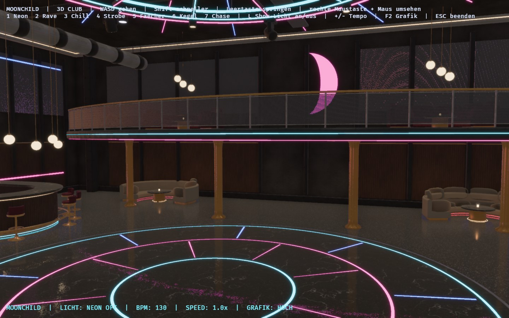

# MOONCHILD 3D (Nur ein Test, gebe diesen aber frei)

Ein begehbarer Club in Rust und Bevy 0.20.1, gestaltet als Luxus-Lounge mit Neon-Akzenten. Alle Modelle und Texturen werden für Moonchild selbst erzeugt; kostenpflichtige Assets, Abos oder Dienste sind nicht nötig.



## Stand auf einen Blick (16. November 2026)

- **Gestaltung:** Luxus-Lounge 2026. Samt- und Bouclé-Sofas, Messing, schwarzer Marmor, Terrazzo, geriffelte Eiche, Rauch- und Opalglas. Dazu Neon-Akzente in Cyan, Magenta und warmem Rot.
- **Rendering:** Deferred Rendering mit Bildschirm-Spiegelungen (SSR), volumetrischem Licht im Club-Dunst, HDR, Bloom, TAA, SSAO und Contact Shadows.
- **Qualitätsstufen:** Mittel, Hoch und Ultra, im Spiel mit F2 umschaltbar. Mesh-LOD für fein gerundete, wiederholte Teile.
- **Branch:** `main` enthält den Lounge-Ausbau und die anschließenden Bühnen- und Lichtverbesserungen.
- **Geprüft:** `cargo check --locked`, `cargo test --locked` (18 Tests) und `cargo build --locked` auf Linux. Der Spielstart in Mittel wurde mit Software-Vulkan geprüft. Bildrate und Aussehen auf echter Hardware sind für den aktuellen Stand noch ungeprüft (siehe [Prüfstand](#prüfstand)).

## Start auf CachyOS / Arch Linux

```bash
sudo pacman -S --needed rustup base-devel clang lld pkgconf alsa-lib libx11 libxcursor libxi libxrandr wayland libxkbcommon libxkbcommon-x11 vulkan-radeon vulkan-tools
rustup default stable
git clone https://github.com/ashrynsilkstone-ui/moonchild-3d.git
cd moonchild-3d
cargo run --release
```

- **Rust 1.97.1 oder neuer:** Bevy 0.20.1 braucht diese Version. Eine ältere Toolchain aktualisierst du mit `rustup update stable`.
- **Startverzeichnis:** Starte aus dem Projektverzeichnis. Beim direkten Start der Binärdatei musst du den Asset-Pfad setzen: `BEVY_ASSET_ROOT="$PWD" target/release/moonchild-3d`.
- **Grafikstufe beim Start:** `MOONCHILD_QUALITY=mittel|hoch|ultra cargo run --release`, Standard ist `hoch`.
- **Pakete:** Paketnamen und Treiber bitte an die eigene Installation anpassen. Vulkan ist erforderlich.

## Steuerung

| Taste | Funktion |
|---|---|
| W A S D | Gehen |
| Shift | Schneller gehen |
| Leertaste | Springen |
| Rechte Maustaste gedrückt + Maus | Umsehen |
| 1 / 2 / 3 | Lichtprogramm Neon / Rave / Chill |
| 4 | Strobe (nur manuell, nie Standard) |
| 5 / 6 / 7 | Lichtprogramm Fächer / Kegel / Chase |
| 8 | Ruhiges Lichtprogramm Lounge |
| L | Show-Licht an/aus; das warme Grundlicht bleibt an |
| + / - | Tempo und BPM |
| F2 | Grafikqualität: Mittel → Hoch → Ultra |
| Escape | Beenden |

Die Galerie erreichst du über die Treppe links. Auf die Bühne führen Stufen rechts, alternativ springst du von vorn hinauf. Die Statuszeile unten zeigt Lichtprogramm, BPM, Tempo und Grafikstufe.

## Was im Club steht

Alle Teile sind prozedurale Meshes mit glatten Normalen, UVs in Metern und MikkTSpace-Tangenten. Erzeugt werden sie in `src/shapes.rs` aus diesen Bausteinen:

- Profil-Sweeps entlang Kurven und Drehkörper,
- abgerundete Quader und Rohre,
- Superquadrik-Kissen,
- geriffelte Drehkörper und Riffelflächen,
- Bögen.

**Tanzfläche und Decke**
- Runde Tanzfläche (Radius 5 m) aus hochglänzendem schwarzem Marmor mit Stahlkante und eingelassenen LED-Streifen.
- Deckenring mit 4,2 m Radius: Neonringe, Nabe mit warmem Hauptlicht, zwölf Speichen, zwanzig radiale Deckenstreifen, sechs warme Ring-Spots und sechs Moving Heads.

**Galerie und Treppe**
- Geschwungene Galerie auf 3 m Höhe entlang eines 20-m-Bogens. Stahlblende mit Cyan- und Magenta-Lichtleiste, Messing-Handlauf, Lochblech-Füllungen (echte Löcher per Alpha-Maske) und geriffelte Säulen aus poliertem Messing.
- Schwebende Treppe mit Riffelblech-Stufen, Handläufen mit Cyan-Glow und warmer Lichtkante an jeder Stufe.

**Lounges** (vier geschwungene „Cloud“-Sofas)
- Auf der Galerie weinroter Samt mit Bouclé-Kissen, unten cremefarbenes Bouclé mit Samtkissen.
- Sitz- und geneigte Rückenkissen sind weich geformte Superquadriken, die auf den Bogen gebogen werden, sodass keine Keilspalten entstehen. Dazu Endrollen und Dekokissen.
- Gepolsterter Sockel auf Messing-Fußleiste mit Lichtfuge, Messing-Paspel an der Rückenoberkante.
- Kleine prozedurale Pflanzenarrangements in Messingvasen auf den bestehenden Couchtischen. Die Blätter besitzen ein einfaches grünes PBR-Material; sie sind keine Fotoscans.
- Couchtisch mit geriffeltem Messingfuß, Marmorplatte, Lichtring und Rauchglaslaterne. Über den Galerie-Lounges je drei Kugelleuchten aus Opalglas.

**Bar**
- Halbrunde Front aus senkrecht geriffelter, geräucherter Eiche, Messing-Sockel, Marmorplatte mit Messingkante und warmer Lichtlinie, Messing-Fußstange.
- Sechs Barhocker mit Messing-Trompetenfuß, Samtsitz und gebogener Samtlehne.
- Rückbar: geriffelter Eichenschrank mit Marmorplatte, Eichenwand mit drei hinterleuchteten Bogennischen in Messingrahmen, Rauchglasregale mit Flaschen.
- Fünf Opalglas-Kugelleuchten an Messingstäben.

**Bühne und DJ**
- Geschwungenes DJ-Pult mit hinterleuchteter Lochblechfront und den DJ-Geräten. Bedienelemente und Bildschirme sind nur optisch, keine funktionierende Musiksteuerung.
- Lautsprecher, abgerundeter Bühnenkörper und Riffelblechbelag, Stufen an der Seite, Bühnenfront mit acht hinterleuchteten Lochblechfeldern. Seitliche Eichenrillen und Messingleisten ergänzen den bestehenden Bühnenkörper.
- Bühnenbildschirm mit eigener 2048×1024-Emissionsgrafik und 60 einzeln animierten Pegelleuchten im Rahmen.
- Traversenportal aus zwei Türmen und Quertraverse mit fünf LED-Leisten und vier weiteren Moving Heads.

**Halle** (`src/hall.rs`)
- **Seitenwände:** Stahlfinnen, unten geriffelte Eichenverkleidung mit Messingabschluss, oben gedimmte, hinterleuchtete Paneele hinter Lochblech (links Cyan, rechts Magenta).
- **Eingangswand:** Eichenverkleidung, Bernstein-Paneele und eine leuchtende Mondsichel als eigenes Moonchild-Motiv.
- **Bühnenrückwand:** je drei hinterleuchtete Akustikpaneele neben der LED-Wand; davor gestufte Bögen aus Messing und warmem Licht.
- **Decke und Abschlüsse:** Lüftungskanäle, Kabeltrasse, Stahlgesims mit warmer Voutenlinie, Sockelleisten.
- **Böden:** Hallen- und Galerieboden aus poliertem Terrazzo.

## Licht

- **Warmweißes Grundlicht ist immer an.** Dazu gehören Deckenspots, Ring-Spots, Nabenlicht, drei Bühnen-Washes, Downlights unter der Galerie, die Leuchten an Bar und Lounges sowie warmes Umgebungslicht. L schaltet nur die farbigen Show-Lichter.
- **Lichtprogramme** mit eigener Farbpalette:
  - **1 Neon, 2 Rave, 3 Chill:** schwenkende Moving Heads in jeweils eigener Palette.
  - **4 Strobe:** nur manuell, nie Startmodus; ein Test prüft das.
  - **5 Fächer:** Strahlenlinie, die auffächert und von vorn nach hinten schwenkt.
  - **6 Kegel:** alle Strahlen auf einem rotierenden Kreis, der sich weitet und zusammenzieht.
  - **7 Chase:** feste Positionen, die Helligkeit springt im BPM-Takt von Kopf zu Kopf.
  - **8 Lounge:** langsam schwenkende, spiegelbildliche Lichtkegel in warmen und zurückhaltenden Farbtönen. Helligkeit der Moving Heads und Punktlichter bleibt konstant, ohne taktbedingtes Blitzen; die Pegelleuchten an der LED-Wand ändern sich langsam.
- **Lichtstrahlen:** In Hoch und Ultra entsteht echtes volumetrisches Streulicht in einem leichten Club-Dunst (Bevy `FogVolume` + `VolumetricFog`). Die Moving Heads werfen dann Schatten, weil Bevy nur schattenwerfende Lichter in den Nebel streut. Bühne, Traverse und Galerie schneiden die Strahlen deshalb sichtbar an. In Mittel gibt es stattdessen günstige additive Lichtkegel ohne Abschattung.
- **Schatten:** Die warmen Grundlicht-Spots werfen Schattenkarten, dazu kommen Contact Shadows. Die pulsierenden Punktlichter werfen nie Schatten.

## Grafikqualität

| | Mittel | Hoch (Standard) | Ultra |
|---|---|---|---|
| Schattenkarten | 1024 px | 2048 px | 4096 px |
| Schattenfilter | Gauß | temporal (mit TAA) | temporal (mit TAA) |
| SSAO | Medium | High | Ultra |
| Bildschirm-Spiegelungen (SSR) | aus | 16 Schritte | 32 Schritte |
| Lichtstrahlen | additive Kegel | volumetrisch, 48 Schritte | volumetrisch, 96 Schritte |
| Moving Heads mit Schatten | nein | ja | ja |
| Warme Deckenspots im Dunst | nein | nein | ja |

- **Rendering:** immer deferred, mit explizitem Deferred- und Depth-Prepass auch in Mittel, wo SSR ausgeschaltet ist. Kamera mit HDR, Bloom (Intensität 0,07), TAA, SSAO und Contact Shadows.
- **Spiegelungen:**
  - Per SSR spiegeln Marmor, Terrazzo und Theke die echte Szene, aber nur bis zu einer Rauheit von 0,32 und nur, was gerade im Bild ist.
  - Außerhalb davon spiegelt eine prozedural gemalte HDR-Umgebungskarte (256² pro Seite).
  - Das ist kein Raytracing.

### Mesh-LOD (`src/lod.rs`)

Fein gerundete, oft wiederholte Teile gibt es in zwei Detailstufen. Bevys `VisibilityRange` blendet sie mit Dithering über.

| Wechsel ab | Teile |
|---|---|
| 7 m | Flaschen |
| 11 m | Barhocker, Dekokissen, Couchtische, Moving-Head-Gehäuse |
| 16 m | Sofakissen und Sofasockel, Barfront, Traversenportal |

Die Nahstufe ist dicht tesselliert, Sofakissen haben zum Beispiel rund 3000 Dreiecke pro Stück. Die Fernstufe hat nur einen Bruchteil davon.

## Texturen und Materialien

`tools/generate_textures.py` erzeugt die kachelbaren Oberflächen deterministisch aus gesetztem Rauschen und gezeichneten Strukturen. Das einzelne Blatt ist nicht kachelbar und verwendet eine eigene UV-Abwicklung. Sie liegen unter `assets/textures/moonchild/`:

| Set | Auflösung | Kachel | Inhalt / Einsatz |
|---|---|---|---|
| `terrazzo` | 2048² | 2 m | polierter Anthrazit-Terrazzo mit Marmor-, Messing- und Weinrot-Splittern (Hallen- und Galerieboden) |
| `marble` | 2048² | 2 m | schwarzer Marmor im Nero-Marquina-Stil mit weißen Adern (Tanzfläche, Theken, Tische) |
| `concrete` | 2048² | 2 m | dunkler Schalungsbeton mit Tafelfugen und Ankerlöchern (Wände, Decke) |
| `stage_screen` | 2048×1024 | Einzelmotiv | eigene Emissionsgrafik auf dem Bühnenbildschirm |
| `bottle_label` | 1024×512 | Einzelmotiv | eigene Moonchild-Etiketten auf den Barflaschen |
| `foliage` | 1024² | Einzelblatt | Blatt mit Adern: Base-Color-, Normal- und ORM-Map (Tischpflanzen) |
| `velvet` | 1024² | 0,5 m | weinroter Samt mit gedrücktem Flor |
| `boucle` | 1024² | 0,3 m | cremefarbenes Bouclé aus Garnschlaufen |
| `brass` | 1024² | 1 m | gebürstetes, leicht lackiertes Messing mit zarter Patina |
| `oak` | 1024² | 1 m | geräucherte Eiche mit senkrechter Maserung (Riffelpaneele, Barfront) |
| `steel` | 1024² | 1 m | gebürsteter Edelstahl |
| `darksteel` | 1024² | 1 m | geschwärzter, pulverbeschichteter Stahl |
| `grille` | 1024² | 0,4 m | Lochblech mit echten Löchern (Alpha-Maske) |
| `treadplate` | 1024² | 0,5 m | Riffelblech |
| `backlight` | 1024² | 1 m | Acryl-Lichtpaneel; die Emissionsmaske wird im Material eingefärbt |

- **Karten pro Set:**
  - `_base` (sRGB),
  - `_normal` (linear, OpenGL/glTF-Konvention),
  - `_orm` (linear: R = Ambient Occlusion, G = Roughness, B = Metallic).
- **Mipmaps:** PNGs enthalten keine. `look::generate_mipmaps` baut beim Laden eine Mipmap-Kette (für Normalmaps renormiert) und aktiviert 16-fache anisotrope Filterung.
- **Maßstab:** UVs sind in Metern angelegt und über `look::tile` skaliert. Jedes Material hat dadurch überall denselben Maßstab.
- **Klarlack:** Terrazzo, Marmor und Eiche haben eine Klarlackschicht, am glänzendsten der Marmor der Tanzfläche.
- **Ohne Textur:** Rauchglas (Regale, Laternen), Opalglas (Kugelleuchten), poliertes Messing (Säulen, Tischfüße).
- **DJ-Faceplates:** liegen unter `assets/textures/dj/` und kommen aus `tools/generate_dj_textures.py`.

## Bewegung und Kollision

`src/navigation.rs` beschreibt jedes Bauteil als Volumen mit Grundriss (Rechteck, Kreis, Kapsel oder Galeriebogen), Unter- und Oberkante, auch gestuft:

- **Begehbar:** Boden, Tanzfläche, Bühne, Bühnenstufen, Treppe, Podest, Galerie.
- **Hindernisse:** Wände, Säulen, Traversentürme, Geländer, Bar, Hocker, Sofas, Tische, DJ-Pult, Lautsprecher.
- **Decke:** Die Galerieunterseite begrenzt Sprünge darunter.

Weitere Regeln:

- Die Augenhöhe folgt der Ebene, Stufen bis 26 cm werden automatisch genommen.
- Das Geländer ist unsichtbar höher als sichtbar, damit man nicht über die Brüstung springt.
- Geometrie und Kollision lesen dieselben Maße aus `navigation::layout`.

Das ist eine vereinfachte 2,5D-Kollision, keine Physik-Engine und keine Mesh-Kollision.

## Projektstruktur

| Datei | Inhalt |
|---|---|
| `src/main.rs` | App-Einstieg, Halle, LED-Wand, Lichter, Lichtprogramme, Steuerung, HUD |
| `src/club_section.rs` | Tanzfläche, Galerie, Treppe, Lounges, Bar, Deckenring, DJ-Pult, Bühnenstufen, Lautsprecher |
| `src/hall.rs` | Wände, Decke, Bühnenrückwand, Traversenportal, Bühnenfront |
| `src/shapes.rs` | prozedurale Mesh-Bausteine |
| `src/look.rs` | Materialien, Mipmaps, Umgebungskarte, Kamera |
| `src/quality.rs` | Qualitätsstufen, Dunst, volumetrisches Licht, SSR |
| `src/lod.rs` | LOD-Abstände |
| `src/navigation.rs` | Bewegung, Springen, Kollision |
| `src/dj_gear.rs` | DJ-Geräte |
| `src/capture.rs` | Screenshot-Rundgang |
| `tools/` | Texturgeneratoren (Python, NumPy, Pillow) |
| `docs/screenshots/` | Aufnahmen aus dem laufenden Spiel |

## Für Entwickler

**Texturen neu erzeugen** (NumPy und Pillow nötig, für das Spiel nicht erforderlich):

```bash
python3 tools/generate_textures.py
python3 tools/generate_foliage.py
python3 tools/generate_bottle_label.py
python3 tools/generate_stage_screen.py
```

```bash
python3 tools/generate_textures.py velvet marble
```

- Ohne Argument erzeugt `generate_textures.py` seine ausgelieferten Sets, mit Namen nur die genannten; `generate_foliage.py` erzeugt die Blatttexturen `generate_bottle_label.py` die Barflaschen-Etiketten und `generate_stage_screen.py` das Bühnenmotiv.
- `MOONCHILD_TEX_SCALE` (Standard 2) skaliert die Auflösung, alle pixelbasierten Größen skalieren mit. Mit `1` entsteht die halbe Auflösung bei gleichem Aussehen.
- Die ausgemusterten Sets `floor` und `leather` werden nicht mehr ausgeliefert, lassen sich aber per Name noch erzeugen.

**Screenshot-Rundgang** aus dem laufenden Spiel:

```bash
MOONCHILD_SHOTS=<Ordner> cargo run --release
```

- `MOONCHILD_SHOT_FILTER=03_bar,09_lounge` nimmt nur passende Ansichten auf, mehrere durch Komma getrennt.
- `MOONCHILD_SHOT_FAST=1` verkürzt die Wartezeiten für langsame Software-Renderer. Die gemessenen Framezeiten sind dann bedeutungslos.
- Der Rundgang überschreibt gleichnamige Dateien im Zielordner. Einen anderen Ordner als `docs/screenshots` wählen, wenn die dokumentierten Bilder erhalten bleiben sollen.

## Prüfstand

**Auf deiner Hardware (6. November 2026, CachyOS, RX 9070 XT, Mesa 26.2.6 RADV)**, früherer Stand vor allen Umbauten vom 16. November:

- Build ohne Warnungen, 12 Tests bestanden.
- Screenshot-Rundgang ohne Panic.
- Framezeiten etwa 5,0–6,5 ms bei 1440×900 ohne V-Sync. Die Läufe schwankten, einzelne waren auf 60 Hz begrenzt.

**Vorheriger Lounge-Stand (16. November 2026, Cloud-Umgebung ohne Grafikkarte, Rust 1.97.1, Mesa lavapipe unter Xvfb):**

- `cargo build --release` ohne Warnungen.
- `cargo test --release` mit 16 bestandenen Tests:
  - zehn Navigationstests (Bühne, Bühnenstufen, Treppe, Galeriegeländer, unter der Galerie, Bar, Tanzflächenkante, Doppelsprung, Traversenturm),
  - Mesh-Windungstest für alle Bausteine, einschließlich Kissen, Riffelung und Bögen,
  - LED-Streifen über der Tanzfläche,
  - Strobe ist nicht Startmodus,
  - alle Lichtprogramme zielen auf gültige Bodenpunkte,
  - Qualitätsstufen,
  - lückenlose LOD-Übergabe.
- Aufnahmen im laufenden Spiel in Stufe Hoch ohne Panic, darunter `docs/screenshots/24_*` bis `29_*` für die Neugestaltung.
- Bei den Aufnahmen gefundene und korrigierte Fehler: Kissen-Ausrichtung, Messing-Säulen, Terrazzo-Funkeln, SSR-Rauschen, zu dichter Dunst, unsichtbare volumetrische Strahlen. Die letzte Korrektur (höher gehängte Galerie-Kugelleuchten) ist nicht mehr neu aufgenommen; `29_lux_lounge_upper.jpg` zeigt noch die alte Höhe.

**Nicht geprüft:**

- Bildrate und Aussehen des aktuellen Stands auf der RX 9070 XT. Dreieckszahl, Deferred Rendering, SSR und volumetrisches Licht kosten deutlich mehr als vorher. Bei Ruckeln mit F2 auf Mittel schalten.
- Stufe Ultra und der neue Stand in Hoch auf echter Grafikhardware. Der frühere Lounge-Stand wurde in Hoch auf Software-Vulkan aufgenommen.
- Längere Bedienung mit echter Tastatur und Maus.

Die Bilder `00_*` bis `13_*` in `docs/screenshots/` zeigen ältere Stände, ab `14_*` stammen sie aus dem Software-Rendering.

### Bühnen- und Lounge-Erweiterung vom 16. November 2026

Auf einem Linux-Prüfserver wurden `cargo check --locked`, `cargo test --locked` mit 18 bestandenen Tests und `cargo build --locked` für den neuen Stand erfolgreich ausgeführt. Die Tests umfassen auch den ruhigen Lounge-Modus und die expliziten Kamera-Prepasses. Im ersten Grafiklauf wurde in Mittel ein Deferred-Prepass-Absturz entdeckt und anschließend behoben. Die Qualitätsstufe Mittel wurde danach mit Mesa llvmpipe erfolgreich gestartet; die verkleinerte In-Engine-Aufnahme der Bühne liegt unter `docs/screenshots/30_lounge_stage.jpg`. Der Kamera-Ausschnitt für `31_lounge_table` wurde später korrigiert und beim Detailausbau erneut aufgenommen; siehe unten. Der Software-Test sagt nichts über Bildrate oder Bildwirkung auf der RX 9070 XT aus. [Prüflauf mit den ausgeführten Tests](https://github.com/ashrynsilkstone-ui/moonchild-3d/actions/runs/43877252457).

## Grenzen und offene Punkte

- **Kein Unreal-5-Niveau:**
  - Es fehlt echte globale Beleuchtung; indirektes Licht wird nur angenähert.
  - Spiegelungen per SSR gibt es nur für sichtbare Bildbereiche.
  - Raytracing gibt es nicht.
  - Modelle und Texturen sind prozedural, keine Fotoscans.
- **Materialien:** Samt hat keinen echten Faserschimmer (Sheen), weil Bevys Standardmaterial das nicht kennt. Pflanzen fehlen.
- **Geometrie:** Der Wandkern ist weiterhin einfach, die sichtbaren Oberflächen sind verkleidet. Auch die neue Bühnenverkleidung und die Pflanzen sind prozedural modelliert.
- **Funktionen:** Keine Audiosynchronisierung, keine Sounddateien, keine NPCs, kein Multiplayer.

## Asset-Herkunft

Siehe [ASSETS.md](ASSETS.md). Alle Geometrie- und Texturdaten sind für Moonchild selbst erzeugt und stehen unter der MIT-Lizenz. Fremde Logos wurden nicht übernommen.

## Lizenz

MIT, siehe LICENSE.

## Detailausbau und Auflösung

Sitz- und Rückenkissen sowie Zierkissen und Polsterrollen haben feinere nahe Meshes. Die Tischpflanzen verwenden eigene doppelseitige Blattmeshes und selbst erzeugte Base-Color-, Normal- und ORM-Maps; aus der Ferne bleiben vereinfachte Blätter sichtbar. Auch die runde Tanzfläche hat mehr Segmente. Die vorhandenen LOD-Stufen bleiben aktiv.

Das Fenster startet mit 1920×1080. Eine andere Auflösung kann beim Start gewählt werden, zum Beispiel:

```bash
MOONCHILD_RESOLUTION=2560x1440 cargo run --release
```

Gültig sind Breiten von 640 bis 7680 und Höhen von 360 bis 4320 Pixeln; ungültige Werte fallen auf 1920×1080 zurück. Höhere Auflösung und mehr nahe Geometrie kosten zusätzliche Rechenleistung. Grafische Qualität und Bildrate auf einer Radeon RX 9070 XT sind dadurch nicht zugesichert. Die Szene nutzt weiterhin Bevy und keine Unreal-Engine-5-Techniken wie Nanite oder Lumen.

Prüfung dieses Detailausbaus: Auf Ubuntu liefen `cargo check --locked`, `cargo test --locked` (19 bestanden) und `cargo build --locked` erfolgreich. Der neue Stand wurde zusätzlich mit Mesa llvmpipe/Vulkan in der Stufe Mittel bei 960×600 gestartet; dabei entstand `docs/screenshots/31_lounge_table.jpg` direkt aus dem Spiel. Der Software-Renderer erlaubt keine Aussage über Qualitätseinstellungen oder Bildrate auf der Radeon RX 9070 XT. [Prüflauf](https://github.com/ashrynsilkstone-ui/moonchild-3d/actions/runs/43888219908).

## Ausbau von Halle, Bühne, Bar und Decke

Die Hallenpaneele und tragenden Säulen haben feinere Rundungen und gemeinsam verwendete Opal-Wandleuchten. Die damaligen animierten Bühnenmodule lagen mit schmalen Fugen dichter zusammen; das gebogene DJ-Pult hat zusätzliche Messingstreben und eine feinere Kontur. Die Barflaschen tragen ein eigenes Moonchild-Etikett und Verschlüsse. Der Deckenring, die verkleideten radialen Lichtleisten, Lüftungsrohre und Lautsprechergehäuse wurden weiter ausgearbeitet. Bestehende Bewegung und Kollisionen bleiben in ihrer bisherigen Form erhalten; die neuen Details bleiben innerhalb beziehungsweise direkt an den bestehenden Einrichtungsgrenzen.

Der Prüfzweig für diesen Ausbau bestand auf Ubuntu `cargo check --locked`, `cargo test --locked` (19 Tests) und `cargo build --locked`. Ein Lauf mit Mesa llvmpipe/Vulkan in Mittel bei 960×600 erzeugte fünf In-Game-Ansichten von Halle, Bar, Deckenring, DJ-Geräten und Bühnenrückwand. Die Bilder liegen als `32_*.jpg` bis `36_*.jpg` unter `docs/screenshots/`. Der Lauf prüft Funktion und eine Softwareansicht, nicht die Leistung oder das Erscheinungsbild auf der RX 9070 XT. Die damalige LED-Wand war eine abstrakte Animation; Fotorealismus oder Unreal-Engine-5-Grafik sind nicht nachgewiesen. [Prüflauf](https://github.com/ashrynsilkstone-ui/moonchild-3d/actions/runs/43891455775).

## Kissenkorrektur und Bühnenbildschirm

Das Biegen der Sofakissen verändert die Händigkeit des lokalen Koordinatensystems. Deshalb werden beim Biegen die Dreiecke nun umgedreht: Ihre sichtbaren Seiten zeigen wieder nach außen und können durch Backface-Culling nicht mehr verschwinden. Ein Regressionstest prüft die Ausrichtung gebogener Sitz- und Dekokissen. Andere Transparenz- oder LOD-Effekte sind dadurch nicht grundsätzlich ausgeschlossen.

Die grobe Bildschirm-Kachelmatrix wurde durch eine eigene 2048×1024-Emissionsgrafik und 60 kleine animierte Pegelleuchten ersetzt. Die Decken- und Showlichtprogramme sowie das warmweiße Grundlicht bleiben bestehen. Die Grafik ist eine eigene Illustration und kein Fotoscan; die Balken sind eine Showanimation und nicht audiosynchron.
