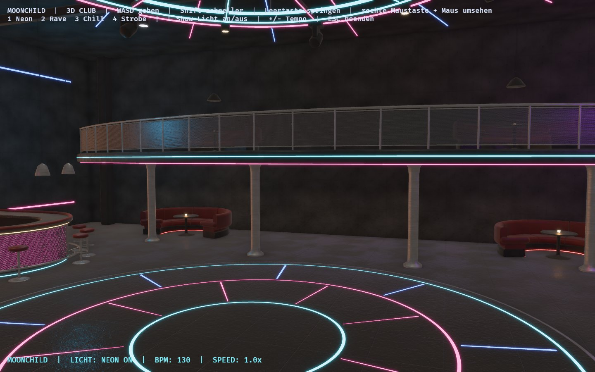

# MOONCHILD 3D (Nur ein Test, gebe diesen aber frei)

Ein kostenloser, selbst gebauter begehbarer Techno-Club in Rust und Bevy 0.20.1. Geometrie und Texturen werden für Moonchild selbst erzeugt. Kostenpflichtige Modelle, Texturen oder Dienste sind nicht nötig.



## Start auf CachyOS / Arch Linux

```bash
sudo pacman -S --needed rustup base-devel clang lld pkgconf alsa-lib libx11 libxcursor libxi libxrandr wayland libxkbcommon libxkbcommon-x11 vulkan-radeon vulkan-tools
rustup default stable
git clone https://github.com/ashrynsilkstone-ui/moonchild-3d.git
cd moonchild-3d
cargo run --release
```

Paketnamen und Treiber bitte bei Bedarf an die eigene Installation anpassen. Vulkan und ein Grafiktreiber sind erforderlich. Starte `cargo run --release` aus dem Projektverzeichnis. Beim direkten Start der Binärdatei muss der Asset-Pfad gesetzt werden: `BEVY_ASSET_ROOT="$PWD" target/release/moonchild-3d`.

## Steuerung

| Taste | Funktion |
|---|---|
| W A S D | Gehen |
| Shift | Schneller gehen |
| Leertaste | Springen |
| Rechte Maustaste gedrückt + Maus | Umsehen |
| 1 / 2 / 3 | Neon / Rave / Chill |
| 4 | Strobe (nur manuell, nie Standard) |
| 5 / 6 / 7 | Fächer / Kegel / Chase |
| L | Show-Licht an/aus, das warme Grundlicht bleibt an |
| + / - | Tempo und BPM ändern |
| F2 | Grafikqualität wechseln: Mittel / Hoch / Ultra |
| Escape | Beenden |

Die Galerie erreichst du über die Treppe links. Auf die Bühne führen Stufen rechts, alternativ springst du von vorn hinauf.

## Der ausgebaute Clubabschnitt

Dieser Abschnitt ist der Qualitätsmaßstab für den Rest der Szene. Alle Teile sind prozedurale Meshes mit glatten Normalen, metrischen UVs und MikkTSpace-Tangenten (`src/shapes.rs`: Profil-Sweeps entlang Kurven, Drehkörper, abgerundete Quader, durchgehende Rohre).

- **Runde Tanzfläche** (Radius 5 m) aus poliertem Boden mit Stahlkante sowie eingelassenen konzentrischen und radialen LED-Streifen.
- **Geschwungene Galerie** auf 3 m Höhe. Sie folgt einem 20-m-Kreisbogen um die Tanzfläche. Dazu gehören eine abgerundete Stahlblende mit Cyan- und Magenta-Lichtleiste, Rohrgeländer mit Pfosten, Füllungen aus echtem Lochblech (Alpha-Maske), runde Stützsäulen und warme Downlights an der Unterseite.
- **Schwebende Treppe** mit Riffelblech-Stufen, Wangen, Handläufen samt Cyan-Glow und einer warmen Lichtkante an jeder Stufe.
- **Vier C-förmige Lounges** (zwei auf der Galerie, zwei darunter) aus bordeauxfarbenem Leder in zeitgemäßer Form: niedrige, durchgehende Sitzfläche über einem zurückgesetzten, beleuchteten Sockel, Channel-Tufting aus schmalen senkrechten Polstern in einer schlanken Stahlschale mit warmer Lichtlinie an der Oberkante, gebürstetem Stahlband und Lichtfuge darunter, sodass das Sofa schwebt. Dazu Wangen aus Stahl mit Lederauflage, ein niedriger Trommeltisch mit polierter Platte, Lichtring am Fuß und Glaslaterne sowie auf der Galerie eine Ring-Pendelleuchte.
- **Halbrunde Bar** mit hinterleuchteter Lochblechfront, Theke aus poliertem Beton, Lederpolster als Armauflage, Fußstange und modernen Barhockern (Trompetenfuß und Säule aus dunklem Stahl, Sitzschale mit Lederpolster und niedriger gebogener Rückenlehne, Fußring mit Streben). Dahinter eine Rückbar mit Bernstein-Lichtwand, Stahlregalen und Glasflaschen sowie drei schlanke Zylinder-Pendelleuchten mit warmem Lichtring.
- **Runde Deckeninstallation**: ein Stahlring mit 4,2 m Radius und Neonringen, eine Nabe mit warmem Hauptlicht, zwölf Speichen mit Lichtleisten, zwanzig radiale Deckenstreifen, sechs warme Ring-Spots und sechs am Ring hängende Moving Heads mit sichtbaren Gehäusen.
- **Geschwungenes DJ-Pult** auf einem Bogen, mit hinterleuchteter Lochblechfront. Die vorhandenen DJ-Geräte stehen darauf. Lautsprecher mit abgerundeten Gehäusen, Lochblechgitter und Membranen. Bühnenkante aus Riffelblech und Stufen an der Seite.

Raum, LED-Wand, Lichtprogramme und DJ-Geräte bleiben erhalten. Die LED-Kacheln sind jetzt abgerundet und sitzen in einem Rahmen.

## Halle und Bühnenrückwand (`src/hall.rs`)

- **Seitenwände**: Stahlfinnen in regelmäßigen Feldern zwischen den Hallenstützen, oben hinterleuchtete Paneele (links Cyan, rechts Magenta), unten Bernstein-Paneele hinter Lochblech. Hinter der Rückbar bleibt die untere Zone frei.
- **Umlaufend**: Sockelleiste aus dunklem Stahl, Stahlgesims unter der Decke mit warmer Voutenlinie.
- **Eingangswand**: Finnenraster mit Bernstein- und Cyan-Feldern hinter Lochblech, dazu eine leuchtende Mondsichel als eigenes Moonchild-Motiv.
- **Decke**: zwei große Lüftungskanäle mit Flanschen und Abhängungen sowie eine Kabeltrasse aus Lochblech.
- **Bühnenrückwand**: links und rechts der LED-Wand je drei hinterleuchtete Akustikpaneele hinter Lochblech, Stahlrahmen, ein Sockel mit Cyan-Lichtlinie unter der LED-Wand.
- **Traversenportal**: zwei Vierpunkt-Traversentürme und eine Quertraverse mit Diagonalverstrebung (ein gemeinsames Mesh), fünf LED-Leisten und vier Moving Heads an Abhängern. Die Türme sind in `navigation` als Hindernisse eingetragen.
- **Bühnenfront**: acht hinterleuchtete Lochblechfelder (Magenta/Cyan im Wechsel) mit Stahllisenen.

Die großen Wandfelder verwenden gedimmte Kopien der Lichtpaneel-Materialien, damit sie glimmen statt zu blenden.

## Texturen

`tools/generate_textures.py` erzeugt acht kachelbare PBR-Sets deterministisch aus gesetztem Rauschen. Sie liegen unter `assets/textures/moonchild/`:

| Set | Auflösung | Kachelgröße | Inhalt |
|---|---|---|---|
| `concrete` | 2048² | 2 m | dunkler Schalungsbeton mit 1-m-Tafelfugen, Ankerlöchern, Poren und Wasserläufen |
| `floor` | 2048² | 2 m | polierter, leicht beanspruchter Betonboden mit Fugen, Kratzern, Polierspuren und Laufwegen (Rauheit) |
| `steel` | 1024² | 1 m | gebürsteter Edelstahl |
| `darksteel` | 1024² | 1 m | geschwärzter, pulverbeschichteter Stahl mit Kratzern (Metallic variiert) |
| `leather` | 1024² | 0,6 m | Bordeaux-Narbenleder mit feinen Falten |
| `grille` | 1024² | 0,4 m | Lochblech mit echten Löchern (Alpha-Kanal, Alpha-Mask-Material) |
| `treadplate` | 1024² | 0,5 m | Riffelblech |
| `backlight` | 1024² | 1 m | Acryl-Lichtpaneel; die zusätzliche Emissionsmaske wird im Material eingefärbt |

Jedes Set besteht aus `_base` (sRGB), `_normal` (linear, OpenGL/glTF-Konvention) und `_orm` (linear: R = Ambient Occlusion, G = Roughness, B = Metallic). AO entsteht aus der Kavität des Höhenfelds. Weil PNGs keine Mipmaps enthalten, erzeugt `look::generate_mipmaps` beim Laden eine Mipmap-Kette (für Normalmaps renormiert) und schaltet 16-fache anisotrope Filterung ein. Das beseitigt das vorher sichtbare Moiré. Die Mesh-UVs sind in Metern angelegt und mit der Kachelgröße aus `look::tile` skaliert, so hat jedes Material überall denselben Maßstab.

Die Auflösung ist gegenüber dem ersten Stand verdoppelt (2048² bzw. 1024²). Alle pixelbasierten Größen im Generator (Unschärfe, Linienbreiten, Kavitäts-AO, Normalstärke, Fugen und Ankerlöcher) skalieren mit dem Faktor `MOONCHILD_TEX_SCALE` (Standard 2). Struktur und physischer Maßstab bleiben also gleich; es kommt feineres Detail hinzu. Mit `MOONCHILD_TEX_SCALE=1` entsteht wieder die alte Auflösung.

**Mehrschichtige Materialien**: Der Hallenboden hat einen dünnen Klarlack, die Tanzfläche einen deutlich glänzenderen, und das Leder eine weiche Schlussschicht (`clearcoat` in `src/look.rs`). Anisotroper Glanz für gebürsteten Stahl wurde getestet und wieder entfernt, weil er im Software-Rendering zu überstrahlten Kanten führte.

Neu erzeugen, nur für Entwickler, braucht NumPy und Pillow:

```bash
python3 tools/generate_textures.py
```

## Licht und Darstellung

- **Warmweißes Grundlicht bleibt immer an**: sechs Deckenspots außerhalb des Rings, sechs Ring-Spots, das Nabenlicht, drei Bühnen-Washes, Downlights unter der Galerie, Pendelleuchten an Bar und Lounges sowie warmes Umgebungslicht. Die Taste L schaltet nur die farbigen Show-Lichter.
- **Schatten**: Die warmen Grundlicht-Spots (Decke, Ring, Nabe, Bühnenmitte, je eine Bar- und Lounge-Pendelleuchte, zwei Galerie-Downlights) werfen Schattenkarten. Zusätzlich sind Contact Shadows aktiv. Die Moving Heads werfen nur in den Stufen Hoch und Ultra Schatten, die pulsierenden Punktlichter nie.
- **Reflexionen**: Eine prozedural gemalte HDR-Cubemap (warme Deckenspots, dezente Neonbänder) speist `GeneratedEnvironmentMapLight`. Dadurch zeigen Glanzboden, Stahl und Leder plausible Glanzlichter. Das ist eine Näherung, **keine echte Spiegelung der Szene**.
- **Kamera**: HDR, kontrolliertes Bloom (Intensität 0,07), TAA, SSAO und Contact Shadows.
- **Lichtkegel**: Die zehn Moving Heads (sechs am Deckenring, vier an der Bühnentraverse) erzeugen in den Stufen **Hoch** und **Ultra** echtes volumetrisches Streulicht. Dafür füllt ein leichter Club-Dunst (`FogVolume`) die Halle, und Bevys `VolumetricFog` tastet ihn per Raymarching ab. Bevy berücksichtigt dabei nur Lichter mit Schattenkarte. Deshalb werfen die Moving Heads in diesen Stufen Schatten, und Bühne, Traverse und Galerie schneiden die Strahlen sichtbar an. Ihre eigenen Gehäuse werfen keine Schatten. In der Stufe **Mittel** gibt es stattdessen die günstigen additiven Kegel-Meshes mit Alpha-Verlauf; diese werden nicht abgeschattet. Mit L (Show-Licht aus) verschwinden die Strahlen in allen Stufen.
- **Lichtprogramme**: 1 Neon, 2 Rave, 3 Chill und 4 Strobe wie bisher. Neu sind 5 **Fächer** (eine Strahlenlinie fächert auf und schwenkt von vorn nach hinten), 6 **Kegel** (alle Strahlen auf einem rotierenden Kreis, der sich weitet und zusammenzieht) und 7 **Chase** (feste Positionen, die Helligkeit springt im BPM-Takt von Kopf zu Kopf). Jedes Programm hat eine eigene Farbpalette. Das warme Grundlicht bleibt in allen Programmen gleich.
- **Strobe** ist nie Standard. Ein Test prüft den Startmodus.

## Grafikqualität und Mesh-LOD

Drei Stufen, umschaltbar im Spiel mit **F2**. Die Startstufe wählt `MOONCHILD_QUALITY=mittel|hoch|ultra` (Standard: hoch). Die aktuelle Stufe steht unten in der Statuszeile.

| | Mittel | Hoch | Ultra |
|---|---|---|---|
| Schattenkarten | 1024 px | 2048 px | 4096 px |
| Schattenfilter | Gauß | temporal (mit TAA) | temporal (mit TAA) |
| SSAO | Medium | High | Ultra |
| Lichtstrahlen | additive Kegel | volumetrisch, 48 Schritte | volumetrisch, 96 Schritte |
| Moving Heads mit Schatten | nein | ja | ja |
| warme Deckenspots im Dunst | nein | nein | ja |

**Mesh-LOD** (`src/lod.rs`): Wiederholte, fein gerundete Teile entstehen in zwei Detailstufen und werden über Bevys `VisibilityRange` mit Dithering überblendet. Das betrifft Flaschen (Wechsel ab 7 m), Barhocker, Lounge-Tische und Moving-Head-Gehäuse (11 m) sowie Lounge-Polster und das Traversenportal (16 m). Die Nahstufe ist dabei dichter tesselliert als vorher, zum Beispiel Barhocker mit 64 statt 32 Segmenten und Flaschen mit 36 statt 20. Die Fernstufe hat nur einen Bruchteil davon. Die Umgebungs-Cubemap für Reflexionen hat jetzt 256² statt 128² pro Seite.

## Bewegung und Kollision

`src/navigation.rs` beschreibt jedes Bauteil als Volumen: Grundriss (Rechteck, Kreis, Kapsel oder Galeriebogen), Unterkante und Oberkante, auch gestuft. Daraus ergeben sich:

- begehbare Ebenen: Boden, Tanzfläche, Bühne, Bühnenstufen, Treppe, Podest und Galerie,
- Hindernisse: Wände, Säulen, Geländer, Bar, Hocker, Sofas, Tische, DJ-Pult und Lautsprecher,
- Decken: die Galerieunterseite beim Springen darunter.

Die Augenhöhe folgt der jeweiligen Ebene, Stufen bis 26 cm werden automatisch genommen. Das Geländer reicht unsichtbar höher als sichtbar, damit man nicht über die Brüstung springt. Wer von einer Kante tritt, darf sich aus einem Volumen herausbewegen, nie hinein. Geometrie und Kollision lesen dieselben Maße aus `navigation::layout`. Das ist eine vereinfachte 2,5D-Kollision, keine Physik-Engine und keine Mesh-Kollision.

## Prüfungen, die tatsächlich ausgeführt wurden

Am 6. November 2026 auf CachyOS (Mesa 26.2.6, RADV) mit AMD Radeon RX 9070 XT:

- `cargo build --release`: erfolgreich, ohne Compiler-Warnungen.
- `cargo test --release`: 12 Tests bestanden. Neun Navigationstests decken Bühne von vorn, Bühnenstufen, Abgang von der Bühne, Treppe hinauf und hinunter, Galeriegeländer, Gehen und Springen unter der Galerie, Bar, Tanzflächenkante und Doppelsprung ab. Dazu kommen ein Mesh-Windungstest, ein Test für LED-Streifen oberhalb der Tanzfläche und ein Test für den Strobe-Startmodus.
- Screenshot-Rundgang im laufenden Spiel mit `MOONCHILD_SHOTS=docs/screenshots cargo run --release` (1440×900, Fenster). Das Protokoll enthielt keine fehlenden Assets und keine Panics. Die Bilder in `docs/screenshots/` stammen aus diesem Rundgang. `00_before_*` zeigt den Stand vor dieser Überarbeitung.
- Frametime: Im letzten Lauf lag sie bei etwa 5,0–6,5 ms pro Frame bei 1440×900 mit abgeschaltetem V-Sync (`docs/screenshots/frame_times.txt`). Wiederholte Läufe schwankten. Einzelne Läufe zeigten konstant 16,67 ms, also eine 60-Hz-Begrenzung, vermutlich durch den Wayland-Compositor bei verdecktem Fenster. Die Werte sind daher nur ein Anhaltspunkt und keine zugesicherte Bildrate.

Nicht geprüft: Steuerung per echter Tastatur und Maus über längere Zeit, andere Auflösungen, andere GPUs.

## Prüfungen zum Hallenausbau und zu den Lichtprogrammen (16. November 2026)

In einer Linux-Cloud-Umgebung ohne Grafikkarte (Rust 1.97.1, Mesa 25.2.8 lavapipe, also Software-Vulkan, unter Xvfb):

- `cargo build --release`: erfolgreich, ohne Compiler-Warnungen.
- `cargo test --release`: 14 Tests bestanden. Neu sind ein Test, dass der Traversenturm die Bühnenecke blockiert, und einer, dass jedes Lichtprogramm gültige Bodenziele liefert.
- Screenshot-Rundgang im laufenden Spiel: `MOONCHILD_SHOT_FAST=1 MOONCHILD_SHOTS=<Ordner> cargo run --release` mit allen 19 Ansichten, ohne Panic. Neu im Repository sind `docs/screenshots/14_*` bis `19_*`. Sie stammen aus diesem Software-Rendering. Die übrigen Bilder sind unverändert die vom 6. November.
- `MOONCHILD_SHOT_FAST` verkürzt nur die Wartezeiten für langsame Software-Renderer. Die Framezeiten aus diesem Lauf (etwa 0,5 fps auf der CPU) sagen nichts über echte Hardware aus.

Die überarbeiteten Möbel wurden genauso geprüft: Build ohne Warnungen, 14 Tests bestanden, Ansichten Bar und beide Lounges im laufenden Spiel aufgenommen (`docs/screenshots/20_*` bis `22_*`, Software-Rendering).

Nicht geprüft: Lauf und Bildrate auf der RX 9070 XT, echte Tastatur- und Mausbedienung der neuen Tasten 5 bis 7.

## Prüfungen zu Grafikqualität, Texturen und LOD (16. November 2026)

In derselben Umgebung (Software-Vulkan, keine Grafikkarte):

- `cargo build --release`: erfolgreich, ohne Warnungen.
- `cargo test --release`: 16 Tests bestanden, darunter neue Tests für die Qualitätsstufen und die lückenlose LOD-Übergabe.
- Stufe **Hoch** im laufenden Spiel aufgenommen: Die volumetrischen Strahlen sind sichtbar, es gab keine Panic (`docs/screenshots/23_quality_hoch_volumetric.jpg`).
- Gefundene und behobene Probleme: Ohne Schattenkarten blieben die Strahlen unsichtbar. Der anisotrope Stahl überstrahlte, er ist entfernt. Zu viel Klarlack spiegelte die vereinfachte Cubemap als orange Fläche auf dem Boden, er ist reduziert.
- **Ultra** und **Mittel**: Die Aufnahmen laufen zum Zeitpunkt dieses Commits noch. Ultra war auf dem Software-Renderer innerhalb von 10 Minuten nicht fertig.

Nicht geprüft: Bildrate in allen drei Stufen auf der RX 9070 XT. Besonders Ultra (4096-px-Schatten für rund 25 schattenwerfende Spots, 96 Raymarching-Schritte) kann auf echter Hardware teuer sein.

## Grenzen und weitere Arbeit

Wände, Decke und Bühnenrückwand haben jetzt Gliederung und Details. Der Wandkern und der Bühnenkörper selbst bleiben einfache Quader, und die Seitenflächen der Bühne sind noch schlicht. Volumetrisches Licht gibt es nur in den Stufen Hoch und Ultra; die Leistung auf echter Hardware ist dafür noch nicht gemessen. Weitere offene Punkte: keine Audiosynchronisierung, keine Sound-Dateien, keine NPCs, kein Multiplayer. Reflexionen sind eine Umgebungs-Näherung, kein Raytracing und kein SSR.

## Asset-Herkunft

Siehe [ASSETS.md](ASSETS.md). Alle Geometrie- und Texturdaten sind für Moonchild selbst erzeugt und stehen unter der MIT-Lizenz.

## Lizenz

MIT, siehe LICENSE.
